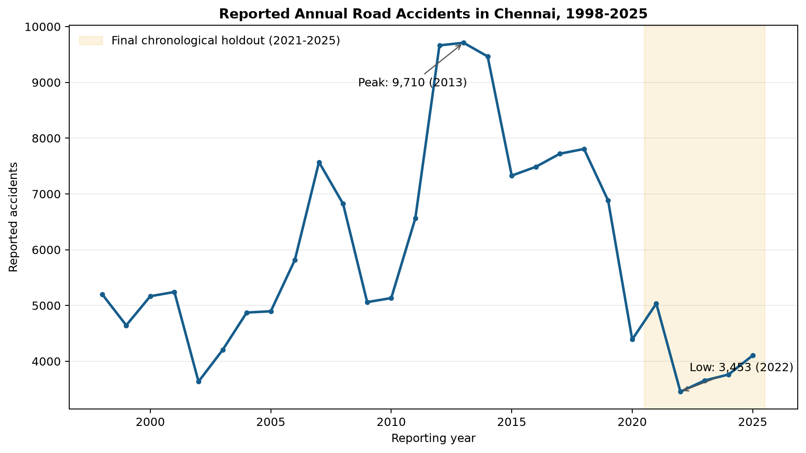
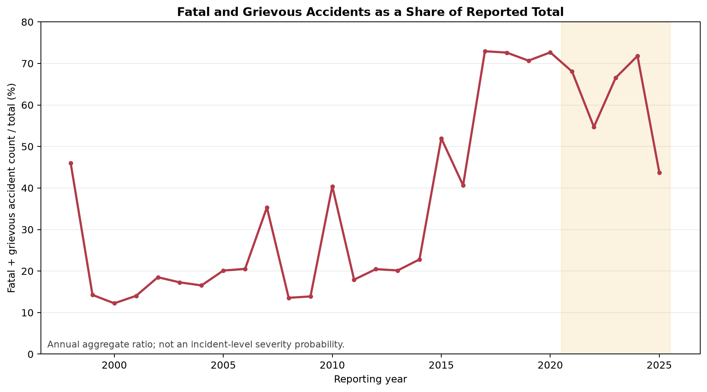
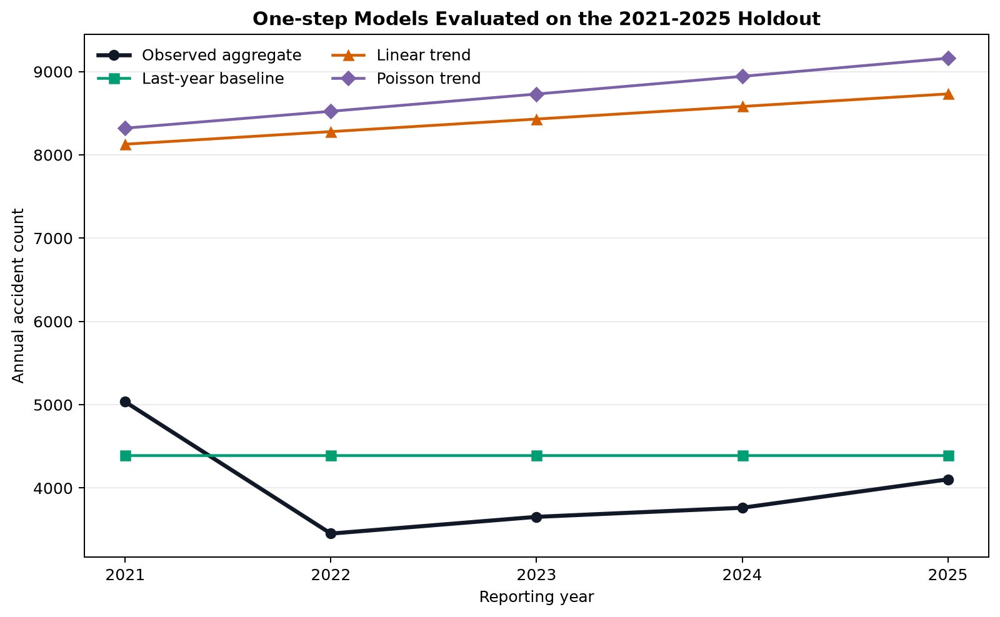

# Chennai Road Accident Trends and Forecast Evaluation, 1998–2025

## A data-science project report based on annual official aggregates

**Study area:** Greater Chennai Police Commissionerate, Tamil Nadu, India

**Prepared:** 14 November 2026

**Primary source:** Greater Chennai Police data published through [OpenCity](https://data.opencity.in/dataset/chennai-road-crashes-data)

**Analysis unit:** One row per reporting year; 28 annual observations

> **Data integrity statement:** The official Chennai crash table available in this project is annual aggregate data. It does not contain individual crash records, event timestamps, or crash coordinates. The repository also contains a generated event-level dataset for demonstration; it was not used in this report. No event-level severity, weather, vehicle, infrastructure, hotspot, or machine-learning conclusions below should be inferred from that synthetic dataset. See [`DATA_INTEGRITY_NOTICE.md`](../DATA_INTEGRITY_NOTICE.md).

---

## Abstract

This report examines how the number and reported severity composition of road accidents in Greater Chennai changed from 1998 through 2025. The source is an official annual table published by Greater Chennai Police through OpenCity. Because it provides 28 yearly aggregates rather than crash-level records, the analysis is limited to annual counts, descriptive ratios, and a small one-step forecasting exercise. Data preparation checks identified no missing years or duplicate years, alongside two internal consistency discrepancies that are retained and documented rather than silently corrected. Annual reported totals reached 9,710 in 2013, fell to 3,453 in 2022, and were 4,104 in 2025. A chronological evaluation compared a last-year baseline with linear and Poisson trend models. The baseline performed best on both rolling-origin validation and the 2021–2025 holdout; trend models substantially overpredicted the holdout. These results show that simple extrapolation is unreliable for this short, structurally changing series. The available data cannot support claims about individual crash risk factors, crash locations, or causal effects.

---

## How this report addresses the evaluation scheme

| Rubric area | Evidence in this report |
|---|---|
| Problem and data | A measurable annual-count question, named source, scope, observation unit, and explicit data limits. |
| Data preparation and EDA | Reproducible checks, derived aggregate measures, documented anomalies, and three figures with interpretation. |
| Modelling and analysis | A persistence baseline plus two justified trend models, chronological holdout, and rolling-origin validation. |
| Evaluation and interpretation | MAE, RMSE, MAPE, side-by-side comparison, error analysis, and limitations. |
| Reproducibility and code | A single command regenerates the analysis tables and figures from the raw source. |
| Report and presentation | Results are separated from interpretation; figures and conclusions are tied to the measured evidence. |

This is a defensible aggregate-data project. It does not claim that this dataset supports incident-level machine learning.

---

## 1. Problem statement and objectives

### Research question

**How did reported annual road-accident totals and the annual share of fatal and grievous accidents change in Greater Chennai between 1998 and 2025, and how accurately can simple year-only models forecast annual totals?**

### Objectives

1. Describe the annual accident-count series and its largest observed changes.
2. Calculate the reported annual share of accidents classified as fatal or grievous.
3. Compare simple annual-count forecasting methods using time-ordered validation.
4. State which conclusions the aggregate data can and cannot support.

The target for forecasting is **reported total accidents per year**. The project does not estimate the probability that an individual road user will crash, nor does it estimate a rate per vehicle-kilometre.

### Why this question fits the available data

The source table has one observation per year and contains counts for fatal, grievous-injury, minor-injury, and non-injury accidents. It is suitable for describing annual totals and evaluating simple time-series forecasts. It has no row for each collision, no event time, and no event location. Therefore, it is not suitable for crash-level classification, linking an individual crash to that day’s weather, or identifying empirical crash hotspots.

---

## 2. Data source and preparation

### Source and scope

The analysis uses [`chennai_road_crashes_1998_2025.csv`](../data/raw/accidents/chennai_road_crashes_1998_2025.csv), published by Greater Chennai Police through [OpenCity’s Chennai Road Crashes Data page](https://data.opencity.in/dataset/chennai-road-crashes-data). The accompanying [source report](../data/raw/accidents/chennai_road_crashes_1998_2025_report.pdf) documents the published tables and marks the most recent reporting years as provisional.

The raw table contains **28 rows and 10 columns**, covering 1998–2025. Each row represents an annual report, not an individual collision. The principal count fields are fatal accidents, grievous-injury accidents, minor-injury accidents, non-injury accidents, and total accidents. The table also includes the corresponding person counts.

Weather, road-network, junction, and police-jurisdiction files are present elsewhere in the repository but are not joined to this annual series. Their time and spatial units do not match the annual crash totals, and they do not supply missing crash-level timestamps or coordinates.

### Preparation steps

1. Read the source CSV without editing it and normalize the year and count fields to numeric types.
2. Check required columns, missing values, duplicated years, and continuity of the annual sequence.
3. Derive:
   - `severe_accidents = fatal_accidents + grievous_accidents`
   - `severe_share = severe_accidents / total_accidents`
   - year-over-year percentage change in the published total.
4. Retain all years. No outlier was deleted or capped: abrupt changes may be meaningful or may reflect changes in recording, and the available metadata cannot distinguish those explanations.
5. Use the published `Total Accidents` field as the forecast target. No missing values were imputed.

### Data-quality checks and decisions

| Check | Finding | Decision |
|---|---|---|
| Row count and years | 28 rows, one per year from 1998 to 2025 | Retain the full series. |
| Missing values in the source table | None | No imputation required. |
| Duplicate reporting years | None | No row removal required. |
| Accident-category sum | In 2013, the four category counts sum to 9,705 while the published total is 9,710, a difference of 5. | Preserve the official total and record the discrepancy. |
| Persons-involved consistency | In 2015, fatal deaths plus grievous- and minor-injury counts sum to 8,206 while “total persons involved” is 7,320, a difference of 886. | Do not use this field for modeling; flag for source clarification. |
| Latest reporting years | The source report marks recent years as provisional. | Treat 2024–2025 comparisons as subject to revision. |

The annual severe share is a **ratio of aggregate counts**, not the probability that a particular crash is severe. It may also be affected by changes in reporting or injury classification. It is shown descriptively, not interpreted as an individual-level risk measure.

---

## 3. Exploratory data analysis

### Annual totals



The highest reported total in the table is **9,710 in 2013**. The lowest is **3,453 in 2022**. The 2025 total is **4,104**, 21.1% lower than the 1998 total of 5,203. The path between these endpoints is not smooth: counts change sharply in several years, including the 2013 peak, the 2020 decline, and the 2022 low. The table alone cannot determine whether those changes reflect travel patterns, policy, reporting practice, or other causes.

### Annual fatal-and-grievous share



The derived aggregate share varies substantially. It is 46.0% in 1998, 12.2% in 2000, 72.9% in 2017, 68.0% in 2021, and 43.7% in 2025. The particularly large changes across years—including the 2024–2025 change—should not be read as a measured change in an individual driver’s or crash’s severity risk. The source’s provisional status and the absence of documentation on year-to-year classification consistency limit that interpretation.

### EDA conclusions

- The official series supports a description of **reported annual counts** and aggregate category composition.
- The data show large temporal variation, so a single straight-line trend is unlikely to describe the whole period well.
- The severe-share series has sharp discontinuities. Until reporting definitions are verified, those discontinuities are a data-quality finding as well as an observed pattern.
- No conclusions about time of day, weather, vehicle type, lighting, road design, or geographic hotspots can be drawn from this annual table.

---

## 4. Modelling design

### Forecasting target and split

The forecasting target is the annual `Total Accidents` count. To prevent future years from leaking into training, the split is chronological:

- **Training:** 1998–2020 (23 annual observations).
- **Final holdout:** 2021–2025 (5 annual observations).
- **Rolling-origin validation:** one-year-ahead forecasts for 2010–2020. For each validation year, the model is fit only on earlier years, then predicts the next year.

No random split or shuffling is used. The fixed split makes the evaluation reproducible and resembles the real forecasting direction. Because the holdout has only five years, scores should be treated as descriptive for this series, not as precise estimates of future performance.

### Models

1. **Last-year persistence baseline:** predicts the previous observed count for the next year. For the fixed 2021–2025 holdout forecast made from 2020, it holds the 2020 value of 4,390 constant across all five forecast years.
2. **Linear trend:** ordinary least squares using reporting year as the sole predictor of annual total.
3. **Poisson trend:** a Poisson regression with a log link and reporting year as the sole predictor. It is included because the outcome is a nonnegative count.

These intentionally simple approaches are proportionate to a 28-row annual dataset. The models do not include policy, population, traffic exposure, or changes in recording practice. The objective is to test whether a simple trend improves on a naive baseline, not to make causal claims.

### Evaluation metrics

- **MAE:** average absolute error in accidents; directly interpretable in count units.
- **RMSE:** gives larger forecast errors more weight.
- **MAPE:** average absolute percentage error; all observed totals are nonzero, so it is defined here.

---

## 5. Results and evaluation

### Rolling-origin validation: 2010–2020

| Model | MAE | RMSE | MAPE |
|---|---:|---:|---:|
| Last-year persistence baseline | 993 | 1,459 | 14.9% |
| Linear trend | 1,767 | 2,080 | 26.2% |
| Poisson trend | 1,918 | 2,216 | 28.7% |

The persistence baseline has the lowest error on these 11 one-year-ahead validation forecasts. Both trend models perform worse, indicating that a smooth trend did not add reliable predictive value in this validation period.

### Final chronological holdout: 2021–2025

| Model | MAE | RMSE | MAPE |
|---|---:|---:|---:|
| Last-year persistence baseline | **646** | **680** | **16.7%** |
| Linear trend | 4,428 | 4,479 | 114.6% |
| Poisson trend | 4,734 | 4,789 | 122.4% |



| Year | Observed | Persistence | Linear trend | Poisson trend |
|---:|---:|---:|---:|---:|
| 2021 | 5,035 | 4,390 | 8,128 | 8,321 |
| 2022 | 3,453 | 4,390 | 8,279 | 8,523 |
| 2023 | 3,654 | 4,390 | 8,430 | 8,731 |
| 2024 | 3,763 | 4,390 | 8,581 | 8,943 |
| 2025 | 4,104 | 4,390 | 8,732 | 9,160 |

The linear and Poisson trend models forecast rising counts of roughly 8,100–9,200 per year, far above the observed 2021–2025 totals. Their percentage errors exceed 100%. The persistence baseline predicts 4,390 for each holdout year and is substantially closer on average. This does not establish that persistence is a dependable forecasting system: the holdout is short, the source’s later years are provisional, and structural changes can make any historical rule fail.

### Error interpretation

The trend models extrapolate the higher counts present in much of their training period. The observed 2021–2025 counts remain well below that extrapolated trajectory. The large errors expose a weakness of fitting smooth trends across a series with sharp level changes. The baseline’s better result is a useful benchmark, not evidence that prior-year counts cause or explain later counts.

No model was selected for operational deployment. No SHAP values, classification accuracy, ROC-AUC, or crash-level confusion matrix are reported here because those metrics would rely on the generated event-level dataset rather than the official annual observations.

---

## 6. Interpretation, limitations, and next steps

### What the evidence supports

The source supports statements about how many accidents were reported in each year, how the published annual categories add up, and how simple year-only forecasts performed under a chronological evaluation. The forecasting comparison suggests that linear and Poisson extrapolation are poor choices for this short series as currently recorded.

### What the evidence does not support

This analysis cannot establish:

- crash-level risk factors or causal effects;
- severity probability for an individual crash;
- hourly, daily, or weather-related crash patterns;
- empirical crash locations or hotspot corridors;
- crash rates per vehicle, road length, or vehicle-kilometre;
- validated forecasts suitable for traffic-safety planning.

These questions require incident-level observations and, for risk rates, suitable exposure denominators. Daily NASA weather data and OpenStreetMap geometry cannot be joined to an annual city total as if they described each crash.

### Limitations

1. **Aggregation:** only 28 annual observations are available; within-year variation is hidden.
2. **Source inconsistencies:** the 2013 accident-category total differs from the reported total, and the 2015 persons-involved fields disagree materially.
3. **Provisional values:** the source report marks recent values provisional and they may change.
4. **Unknown comparability:** the table does not document whether recording definitions and coverage remained stable through the full period.
5. **Short evaluation window:** the final test consists of five years, so performance estimates are uncertain.
6. **No exposure denominator:** totals cannot be interpreted as relative risk across years or locations without traffic exposure data.

### Next steps

1. Ask the data publisher or Greater Chennai Police for documentation of category definitions, the 2013 and 2015 discrepancies, and the status of the latest years.
2. Seek genuine incident-level records containing crash date/time, location, severity, and vehicle information. If unavailable, keep the project framed as annual aggregate analysis.
3. If incident records become available, validate provenance and coding first, then build a new crash-level analysis. Do not reuse the synthetic rows as observations.
4. Obtain traffic exposure data before making comparative risk claims.
5. Repeat the forecasting evaluation when additional stable annual observations become available.

---

## 7. Reproducibility and code

The figures, annual derived table, rolling validation predictions, final holdout predictions, and model-comparison table are regenerated from the raw CSV by:

```bash
python -m pip install -r requirements.txt
python main.py --stage report
```

The analysis script is [`scripts/build_aggregate_report.py`](../scripts/build_aggregate_report.py). It reads the official raw annual table, checks required fields and year continuity, calculates aggregate features, performs the fixed chronological evaluation, and writes outputs to `reports/figures/` and `results/metrics/`. The script does not load `chennai_accident_severity_modeling_dataset.csv` or the saved event-level models. The procedure is deterministic and uses no random split, so a random seed is not applicable. The interactive workflow in [`app.py`](../app.py) presents the data audit, EDA, models, evaluation, and interpretation; launch it with `python main.py --stage app`.

The former collection and event-level analysis modules remain legacy code and are outside this verified empirical workflow. A collection runner in that legacy code has a known method-name mismatch noted in [`DATA_INTEGRITY_NOTICE.md`](../DATA_INTEGRITY_NOTICE.md); do not treat it or the synthetic event-level artifacts as verified empirical results.

---

## 8. Conclusion

The available official Chennai data supports a careful study of annual reported accident counts, but not the event-level questions claimed by the legacy project outputs. The annual series has major fluctuations and known internal inconsistencies. In a chronological forecasting comparison, the last-year baseline outperformed both linear and Poisson trend models on rolling validation and the five-year holdout. The result argues for restraint: neither smooth trend extrapolation nor the current event-level synthetic model should be presented as a reliable basis for road-safety decisions. Authentic incident-level data, clarified source definitions, and exposure measures are the necessary next steps for a defensible crash-risk study.

---

## References

1. Greater Chennai Police, *Chennai Road Crashes Data, 1998–2025*, published through [OpenCity](https://data.opencity.in/dataset/chennai-road-crashes-data). Local source files: [`CSV`](../data/raw/accidents/chennai_road_crashes_1998_2025.csv) and [`official report PDF`](../data/raw/accidents/chennai_road_crashes_1998_2025_report.pdf).
2. Greater Chennai Police and OpenCity source metadata: [`DATA_SOURCES.md`](../DATA_SOURCES.md).
3. Project data-integrity limitations: [`DATA_INTEGRITY_NOTICE.md`](../DATA_INTEGRITY_NOTICE.md).
