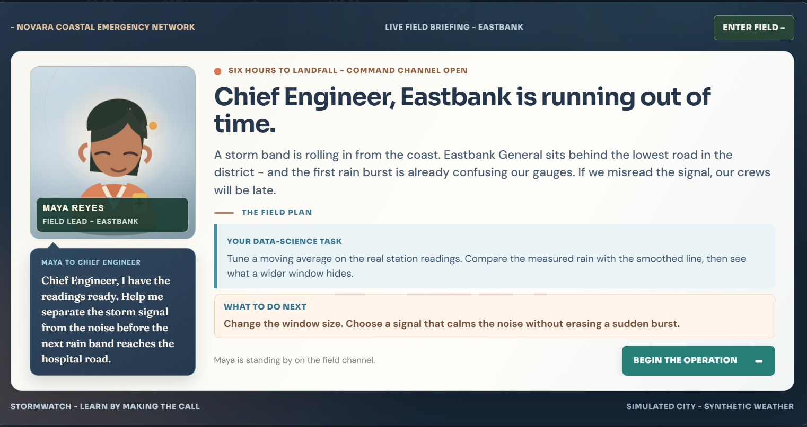
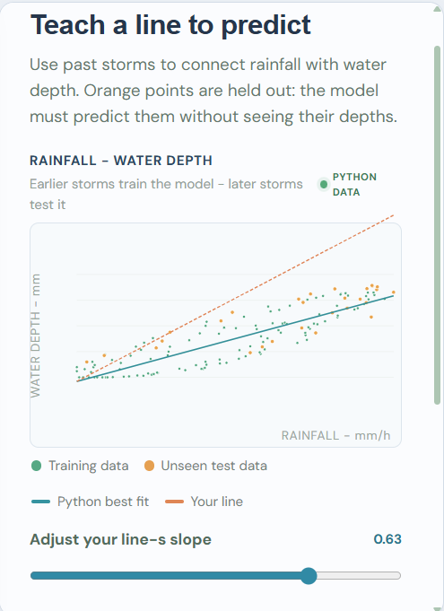
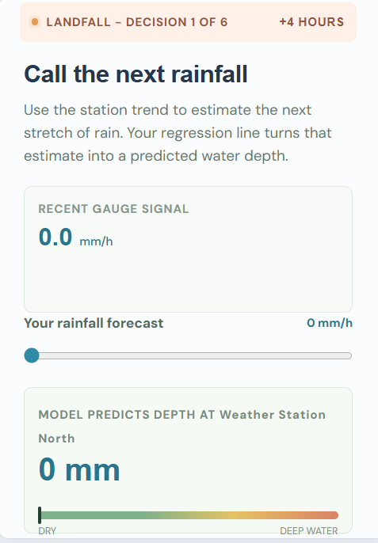

# STORMWATCH: How to Play and What You Learn

## Mission

You are Eastbank's Chief Engineer. With field lead Maya Reyes, use rainfall data and a flood simulation to keep Eastbank General's access road open and help protect the coastal community. The weather and city are simulated for learning; they are not real emergency forecasts.

## How to Play

1. **Read the rain:** Select a weather station and adjust the moving-average window. Compare the raw readings with the smoothed line, then choose a window that reduces noise without hiding a sharp rainfall burst.
2. **Build a model:** Explore rainfall and water-depth observations. Adjust the regression line and compare its mean absolute error with Python's best-fit line. Green observations are used to train the model; orange observations are held out to test how well the relationship generalizes.
3. **Prepare the city:** Choose an available pump, barrier, or rescue boat. Place it on a valid map tile, keeping its cost, placement rules, and the hospital route in mind.
4. **Ride the storm:** Set a rainfall forecast using the station readings. Review the regression model's predicted water depth, then lock the forecast. The flood advances four simulated hours; compare your prediction with the result and repeat for six decisions.
5. **Review the report:** See your forecast errors and the city's outcome. Maya presents a mission score based on forecast accuracy (50%), hospital access (35%), and road safety (15%).

Click a station to inspect its readings. Drag the map to pan and use the map controls or mouse wheel to zoom. Use **Ask Maya** whenever you need guidance for the current task. Maya also briefs the player when each new task or forecast round begins.

## Learning Outcomes

- **Moving averages and noisy signals:** See how window size smooths variation while potentially masking short-lived peaks.
- **Linear regression and generalization:** Fit a line between rainfall and water depth, compare a trial line with the least-squares fit, and test against unseen observations.
- **Residuals and forecast evaluation:** Measure the gap between predicted and simulated water depth, then use previous errors to inform later forecasts.
- **Data-informed decisions:** Connect uncertainty, resource limits, and placement choices to the simulated flood's effect on roads and hospital access.

## Playtest Evidence and Feedback

The following screenshots show the field briefing, regression activity, and a live flood forecast task.

### Peer feedback

**Rohith T.N (CS24b2010):** The moving-average task helped me understand how smoothing reduces noise but can hide sudden rainfall peaks. The forecast rounds showed me how a prediction error, or residual, is measured against the simulated outcome.

**Sushant Kumar (Cs24i1066):** The regression task made the difference between training data and unseen test data clear. Adjusting the line and comparing its error helped me understand why a good fit should also generalize to new storms.
